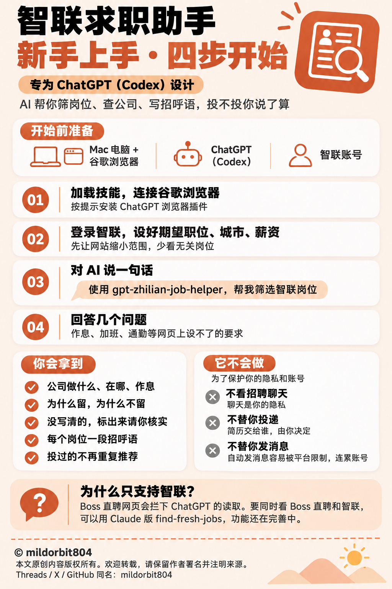

**智联招聘求职助手**

帮你按自己的要求筛选智联岗位，整理公司信息，并为合适岗位写招呼语。

**能做什么**

- 核对职责、薪资、作息和公司资料，说明保留或排除的原因。
- 跳过重复及已投岗位；投过后重新发布的，会提醒你决定是否再投。
- 给每个合适岗位附上链接和对应招呼语。
- 查找已有岗位、屏蔽偏题标题，中断后继续。

筛选条件由你决定。作者的核查经验可以选用、修改，也可以全部不用。

**和其他求职工具有什么不同**

常见的求职自动化工具大致有四种做法：批量自动投递；按条件搜索并抓取前若干条结果；借助登录凭证调用平台接口，代为沟通和跟进；招聘平台自带的匹配与一键投递。本技能在以下几处做了不同的取舍。

| | 常见做法 | 本技能 | 这样取舍的原因 |
|---|---|---|---|
| 投递与沟通 | 自动投递、批量打招呼、跟进招聘方 | 只交付候选岗位和招呼语，由求职者审阅后自行发送 | 每次投递都代表求职者本人，发出后无法撤回；批量投递会降低单次质量，也容易触发平台限制 |
| 招聘消息 | 读取沟通列表，汇总回复 | 不打开、不读取任何聊天 | 沟通往来涉及个人判断与隐私，应由本人掌握 |
| 页面读取 | 调用接口、提取登录凭证、模拟请求 | 只在本人已登录的浏览器中正常点击和阅读 | 不触碰隐藏接口和验证机制，账号风险更低，也不会因接口变动整体失效 |
| 扫描深度 | 取前若干条或首页结果 | 每个期望职位翻到列表终点或约定的时间范围；中途停止时标明停在哪里 | 漏看合适岗位的代价高于多看几页；已看过的岗位自动跳过，额外消耗主要是时间 |
| 筛选结论 | 只给结果，或仅提示无匹配 | 每条保留或排除都写明对应哪项要求、依据哪段原文；直接跳过的按原因计数 | 结论可以核对，误判才能被发现 |
| 理解职位描述 | 关键词匹配 | 读完整语句和上下文，区分“无需加班”与“必须加班”、岗位名称与实际职责 | 字面匹配既会误排合适岗位，也会放过名不副实的岗位 |
| 信息缺失 | 当作符合，或当作不符 | 网页未标注的作息、未显示的注册资本等标为待核，交由求职者自行确认 | 网页没写不等于不符合 |
| 已投岗位 | 不记录，或排除整家公司 | 同公司同岗位去重，兼容公司名后缀写法和招聘编号变化；重新发布的岗位附上次投递日期，由求职者决定是否再投 | 避免重复投递，同时不误伤同一公司的其他岗位 |
| 筛选标准 | 内置开发者偏好，或仅有平台筛选项 | 标准由使用者确认；作者的核查经验默认关闭，最后询问是否采用 | 每个人的条件不同，他人的经验只作参考 |

**适合谁**：重视每次投递的质量、希望看清筛选理由的求职者。若目标是短时间内大量投递，自动投递类工具更合适。

**怎么开始**

加载技能后，先连接谷歌浏览器，按提示完成插件安装、登录或授权，再在浏览器中登录智联，设好期望职位、城市和薪资，然后对 AI 说：

> 使用 gpt-zhilian-job-helper，帮我筛选智联岗位。

它会补问必要要求，核对已投名单，再筛选并交付结果。网页没写清的信息会标出来请你补核，招呼语由你审阅和发送。

**使用条件**

需要能操作浏览器、运行本地程序的 AI 助手，以及 Python 3.9+。已在 macOS 实跑并完成本地模拟；Linux 尚未实测，Windows 原生暂不支持。

**适用的 AI 助手**：本技能专为 ChatGPT（Codex）设计，已实际使用。Claude 理论上也可使用，尚未实测；豆包工作（本地电脑模式）和 WorkBuddy 能否使用尚不确定。

**为什么只支持智联**：Boss 直聘网页会检测浏览器的调试状态，ChatGPT 的浏览器工具读取页面时会被识别，页面随即变成空白，无法正常读取。为避免影响账号，本技能不尝试绕过。需要同时看 Boss 直聘和智联的，可以使用已发布的 Claude 版 [find-fresh-jobs](https://github.com/mildorbit804/find-fresh-jobs)，它已能把两个平台的新岗位整理成清单，公司核查、招呼语等功能还在完善中。

技能不读取招聘聊天、不代发、不代投。记录保存在自己的项目中；提供给 AI 的内容仍按所用服务的数据处理设置执行。

## 新手说明图

图中已投去重的补充：投递后重新发布的岗位，默认会提醒你决定是否再投；也可以要求始终跳过。

## 获取与使用

下载本仓库后，将 `gpt-zhilian-job-helper` 文件夹作为技能加载到 Codex。连接浏览器后，按上方说明开始。个人求职条件和运行记录请保存在自己的项目中。

## 版本与许可

首个公开准备版本：v0.1.0（2026-11-03）。许可条款尚未指定，当前不声明 MIT 等开源许可。
